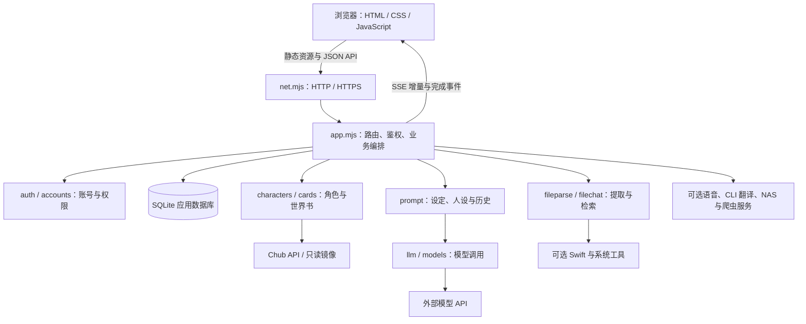

# 架构说明

应用采用单个 Node.js 服务进程提供静态页面、JSON API 和 SSE 回复流。浏览器通过原生 ES Modules 加载视图，服务端以 SQLite 保存应用状态，再按需连接模型、Chub 和可选外围服务。

## 模块布局

| 目录或模块 | 职责 |
| --- | --- |
| `server.mjs` | 加载配置、打开数据库、初始化管理员及服务对象、启动监听与关闭清理 |
| `server/config.mjs`、`net.mjs`、`static.mjs` | 环境配置、HTTP / HTTPS 同端口处理、静态文件 |
| `server/app.mjs` | API 路由、权限门禁、业务编排、会话生成、上传和管理接口 |
| `server/db.mjs` | 表结构、版本迁移、事务、设置与用量存储 |
| `server/auth.mjs`、`accounts.mjs` | 密码哈希、登录会话、限流、邀请码与密码重置 |
| `server/characters.mjs`、`chub.mjs`、`cards.mjs`、`png.mjs` | Chub 角色、自建卡、世界书、角色卡 PNG 元数据处理 |
| `server/prompt.mjs`、`chat-settings.mjs` | 提示词组装、会话级设定及人设覆盖 |
| `server/llm.mjs`、`models.mjs`、`proxy.mjs` | 模型选择、密钥管理、兼容 API、SSE 解析、连接与代理 |
| `server/translate.mjs`、`translation-history.mjs`、`grok-cli-*.mjs` | 卡片翻译、版本记录、可选 CLI 翻译与额度检查 |
| `server/fileparse.mjs`、`parse-worker.mjs`、`filechat.mjs` | 文件解析工作线程、文本提取、分块及 BM25 检索 |
| `server/voice.mjs` | 录音存储、ASR 请求、文本整理及可选音频转换 |
| `server/mirror-*.mjs`、`nas-*.mjs`、`nas-image-reader.py` | 只读角色/图片镜像、缩略图缓存及可选 NAS 读取适配 |
| `server/costs.mjs`、`pricing.mjs`、`logs.mjs`、`crawler.mjs` | 用量与费用、日志及外部爬虫控制接口 |
| `public/js/app.js`、`api.js`、`store.js`、`views/` | 页面外壳、Hash 路由、API 与流读取、共享状态和各页面 |
| `public/css/`、`public/i18n/` | 样式与中文界面文案 |
| `tools/` | Swift PDF 文本提取与图片 OCR 源码 |
| `scripts/create-admin.mjs`、`test/` | 管理员运维入口与 Node.js 测试 |

## 一次角色对话的链路

1. 浏览器提交会话消息；服务端根据路由处理请求格式、Origin、登录会话和角色权限。
2. 业务层检查会话归属、角色卡可见性、内容设置和用户用量限制。当前会话已有生成任务时拒绝重复生成，并维护用户在途请求计数。
3. 确定角色定义及译文版本，叠加会话级覆盖与用户人设，读取未删除的历史消息，并选取世界书条目。
4. `buildMessages()` 进行宏替换，依次加入角色或剧情规则、设定、用户、示例、语言与安全规则、裁剪后的历史，以及可选历史后提示。
5. 按「会话模型 → 用户默认 → 全站默认 → 第一个启用模型」选择上游。`llm.mjs` 解析兼容 API 的增量与 usage，服务端发送 `user`、`delta`、`done` 或 `error` 等 SSE 事件。
6. 生成结果与用量在数据库事务中保存。中断或错误时，已经生成的部分在可获得时会保留；连接关闭会触发上游取消。无正文但已有 usage 的调用可以单独记账。

在途计数和生成锁属于进程内状态。当前实现面向单进程部署，不能直接推断多副本部署具有相同的并发互斥和限流效果。每日上限的一个历史测试仍失败，见 [README 测试说明](../README.md#测试与已知问题)。

## 角色稳定机制与上下文边界

角色信息每轮重新进入 system 消息，而不是只在首次开聊时提供。自建剧情卡使用叙述者规则；普通角色卡使用角色名、描述及性格。用户称呼优先采用人设名，其次显示名，最后用户名；会话人设可以覆盖全局人设。

提示词预算按字符计数，而非模型 token 计数：示例最多 2,000 字符，历史目标预算 24,000 字符且至少保留最后一条，世界书预算 4,000 字符。世界书依据近期消息匹配并按顺序注入。它们不等同于无限记忆，也没有对输出角色一致性的强制校验。

角色卡自带的 `system_prompt` 可替代默认开头，`post_history_instructions` 会在历史后作为 system 消息加入。这是可配置行为，也意味着外部卡片会影响模型指令；当前机制不能被视为完整的指令隔离或注入防护。

## 文件与语音链路

文件解析在工作线程和受限时长的子进程中进行。纯文本由 Node.js 解码、清理；Office 文档、PDF 和图片等格式按类型调用系统工具。原始上传文件在解析阶段暂存，解析结束清理；提取文本可进入后续上传暂存或会话数据库。

文件会话对较短正文直接构造上下文，较长正文分块后通过 BM25 选取相关片段；这是本地文本检索，没有向量数据库依赖。当前阈值、分块和提示词逻辑见 `filechat.mjs` 与 `app.mjs`。

语音录音通过 `voice.mjs` 送至 ASR 服务，必要时执行本地音频转换，再将识别文本整理为聊天输入。录音原件保存在数据目录中；文本或音频会按所选功能发送至外部服务。

## 数据、权限与凭据

主数据库位于 `DATA_DIR/aichat.sqlite`，使用 WAL 和外键，迁移版本由 `PRAGMA user_version` 管理。主要数据包括用户、会话令牌哈希、角色缓存、自建卡、聊天消息、翻译版本、文件文本及分块、语音元数据、邀请/重置记录、模型设置、用量与日志。当前迁移版本为 14。

本地镜像使用独立 SQLite 文件，以只读连接打开；镜像图片和应用缓存也有独立目录。仓库仅提供读取适配，不包含镜像数据库、完整采集部署或个人运行数据。

| 范围 | 实现与边界 |
| --- | --- |
| 密码 | scrypt 加盐哈希；密码重置及禁用等操作按对应流程使会话失效 |
| 登录会话 | Cookie 携带随机令牌，数据库保存令牌哈希；Cookie 使用 HttpOnly、SameSite=Lax，在安全连接下使用 Secure |
| 角色权限 | `super`、`admin`、`tenant`；服务端路由和业务层校验管理范围与资源归属 |
| 会话内容 | 应用接口仅允许会话本人访问聊天内容、文件正文和录音；超级管理员也不能通过管理接口读取其他用户的会话内容 |
| 角色卡 | 按所有权和可见性访问；超级管理员保留自建卡只读管理入口，含私有和已删除卡片 |
| 写请求 | 校验提供的 Origin 与 Host，并检查请求体类型；上传路由有单独的格式和大小约束 |
| 模型密钥 | 从指定密钥文件读取，或以 AES-256-GCM 加密后入库；加密主密钥为 `DATA_DIR/secret.key`，按 0600 权限保存 |
| 外部凭据 | Chub 密钥、NAS 和爬虫令牌、CLI 登录状态均由部署者提供；服务商密钥不应返回浏览器 |
| 出站访问 | 模型直连检查 HTTPS、DNS 和目标地址；头像有来源白名单。代理连接由代理解析目标 DNS，边界不同于直连 |

模型密钥加密只覆盖指定凭据字段，并不加密整个 SQLite 数据库、录音或聊天正文。聊天内容不是端到端加密；部署者直接控制数据库、文件和运行环境，因此应用接口的会话归属校验不代表部署者无法访问内容。备份需要保管数据库与 `secret.key`；文件系统访问权限、备份保护及公开网络部署由部署者负责。管理角色仍有账号恢复和重置码能力；接口所有权校验不代表能够抵御部署者或账号接管后的访问。故障日志采用摘要和错误码，但不能将整个运行目录当作适合公开发布的材料。

## 部署与验证范围

源码没有 npm 运行依赖，也没有需要构建的前端包。基础服务由 `node --env-file=.env server.mjs` 启动；可选集成分别依赖外部账号、CLI、镜像及系统工具，配置入口见 [README](../README.md#配置参考)。

`MODEL_SEED_PROBE=0` 关闭模型预置后的真实探测调用；`SWIFT_WARMUP=0` 仅关闭启动预编译。自动启用这些能力前，应先补齐对应配置。模型兼容性、工具链可用性、服务商费用与上游策略不能由源码本身保证。

权限及迁移专项 9 项、其他专项 34 项通过；离线全量 360 项中 298 项通过、62 项仍失败。完整结果与失败名称见 [测试记录](TESTING.md)。真实外部服务及完整跨平台兼容性未在本次验证中覆盖。
